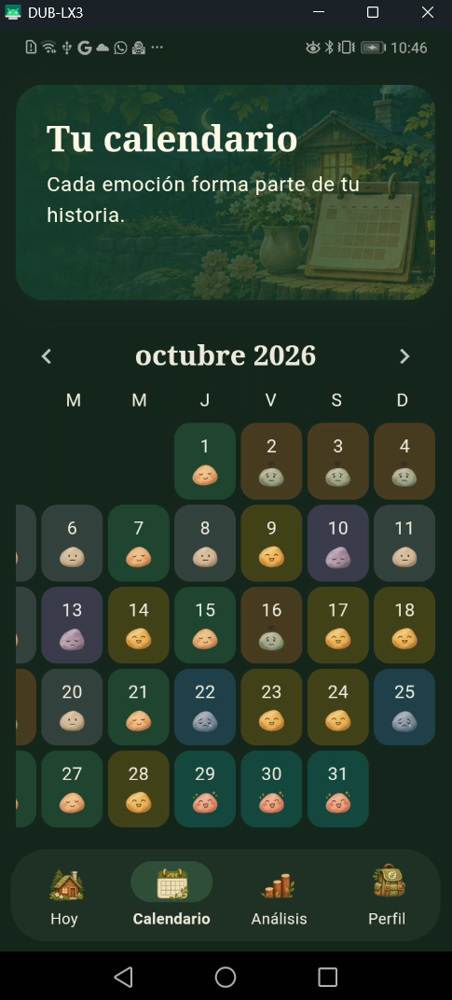
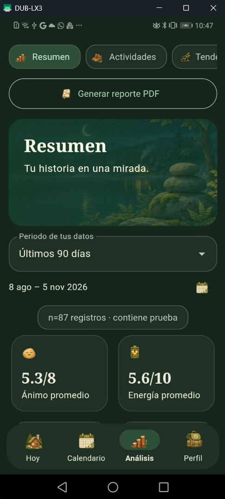
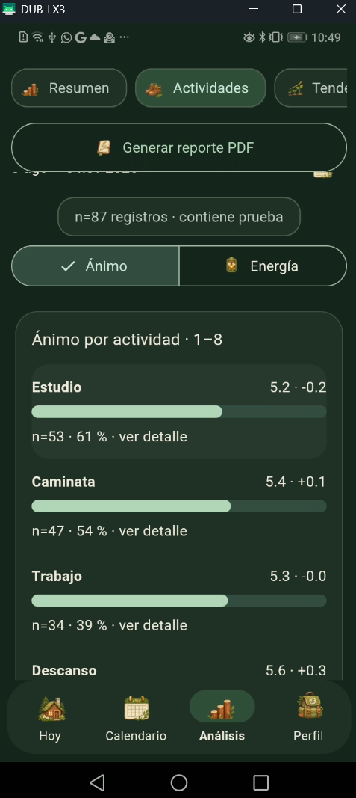
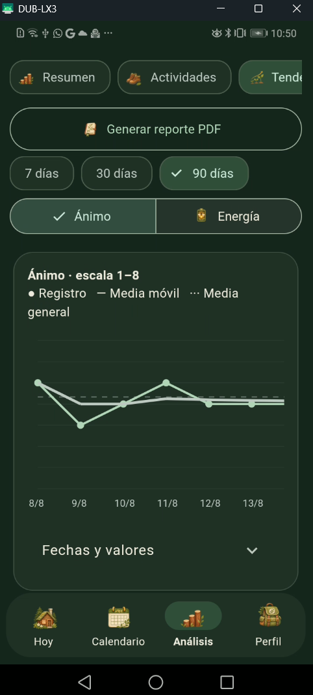
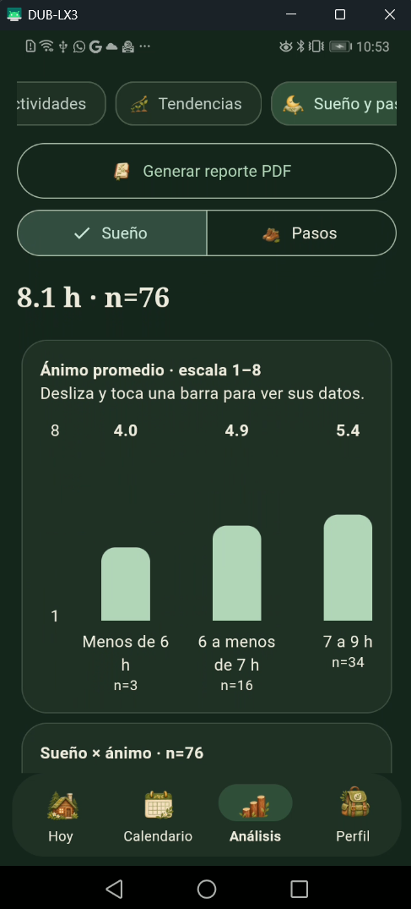
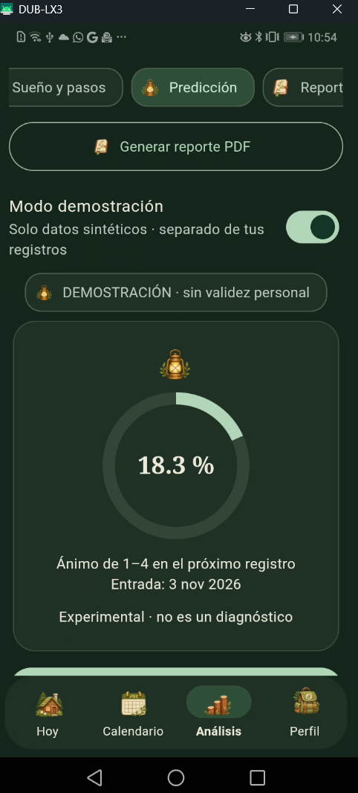
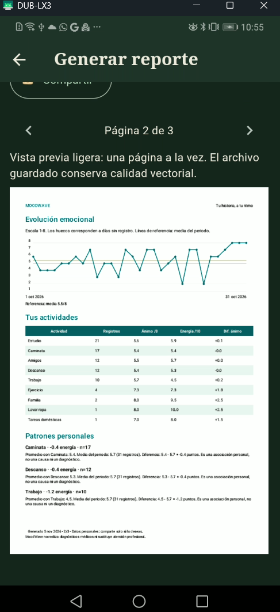
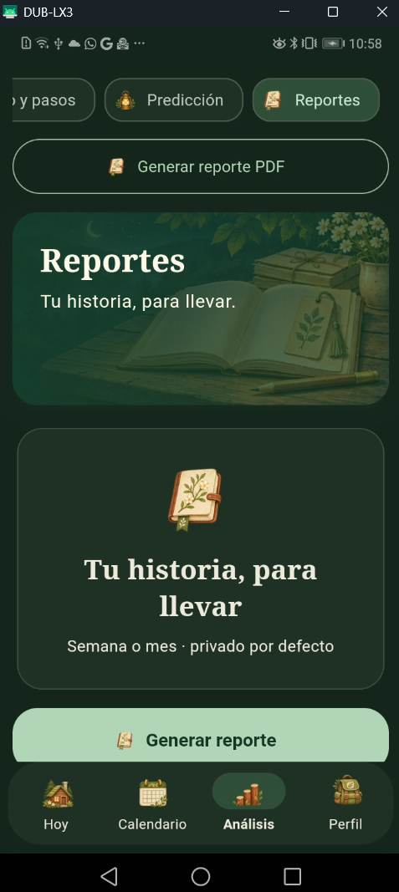
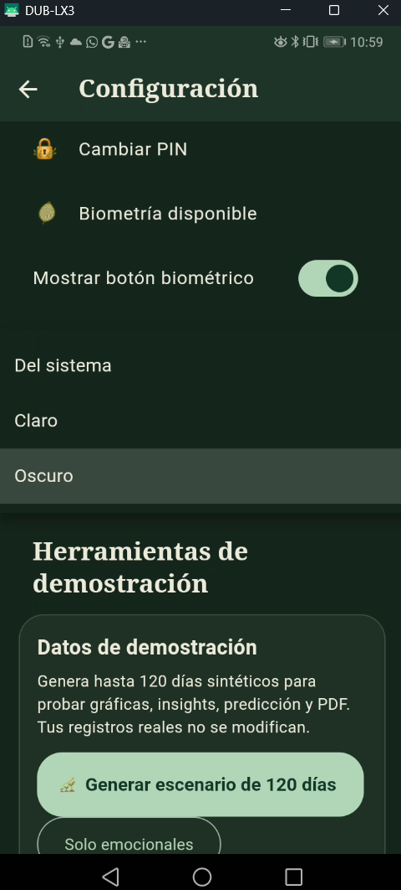

# MoodWave

MoodWave es un diario emocional privado para Android, construido con Flutter. Permite registrar ánimo, energía, actividades, sueño, pasos y reflexiones; después transforma esos registros en estadísticas, tendencias, insights, reportes PDF y una predicción emocional local.

La rama `prototipo_final` combina la funcionalidad completa de `main` con la identidad visual **Refugio natural** de `design/refugio-natural`.

El proyecto Kotlin de referencia se encuentra en `C:\Users\soria\AndroidStudioProjects\MoodWave`. Se utilizó únicamente como referencia y no se convirtió ni modificó.

## Recorrido visual

### Hoy

La pantalla principal permite registrar cómo se siente la persona, su energía, actividades, sueño, pasos y una reflexión opcional. El recorrido se organiza en **Sentir**, **Vivir** y **Recordar** para que registrar un día no se sienta como llenar un formulario.


### Calendario

El calendario presenta los registros por fecha mediante rostros y colores emocionales. Se puede navegar por meses, consultar el detalle de un día, editarlo o eliminarlo.



### Análisis y resumen

La sección **Análisis** reúne estadísticas, patrones, tendencias, salud, predicción y reportes. El resumen incluye media, mediana, moda, desviación y cobertura del periodo.



### Actividades e insights

MoodWave compara el promedio de ánimo o energía asociado con cada actividad frente a la media general. Cada insight muestra promedio, diferencia, tamaño de muestra, dirección y una explicación bajo demanda.



Los patrones se consideran suficientes cuando existen al menos 14 días totales y 5 observaciones del grupo. Las asociaciones son descriptivas: no demuestran causalidad, diagnóstico ni tratamiento.

### Tendencias

La pestaña **Tendencias** permite analizar los últimos 7, 30 o 90 días. La gráfica conserva los días sin registro como ausencias y superpone una media móvil para observar la dirección general.



### Sueño y pasos

Esta pestaña relaciona datos de salud registrados manualmente o importados con ánimo y energía mediante gráficas de dispersión. Los valores faltantes no se convierten artificialmente en cero.



### Predicción emocional

El módulo de predicción utiliza una regresión logística pequeña, entrenada localmente en el dispositivo. Estima la probabilidad de que el siguiente registro disponible tenga ánimo bajo (valores 1–4).



El modelo usa ánimo, energía, sueño, pasos, promedios de 3 y 7 días, tendencia, día de semana, actividades y marcas de ausencia. Se entrena con los registros ordenados cronológicamente, usa aproximadamente 80% para entrenamiento y 20% para evaluación temporal, requiere al menos 31 registros y compara sus resultados con una referencia que repite la clase del registro actual. Calcula precisión, recall y F1. No utiliza reflexiones ni datos de seguridad, no envía los datos a servidores y no realiza diagnósticos.

La predicción se refiere al siguiente registro disponible, no necesariamente al día calendario inmediato. Cuando se agregan o editan registros, el modelo debe volver a entrenarse.

### Reportes PDF

Desde **Análisis → Generar reporte PDF** o desde **Reportes**, el usuario puede generar un documento con estadísticas, tendencias, actividades, insights, gráficas y advertencias de interpretación.





### Tema oscuro

La aplicación respeta la preferencia claro, oscuro o sistema. Las ilustraciones del Refugio natural cambian entre escenas diurnas y nocturnas.



## Identidad visual: Refugio natural

El rediseño utiliza una metáfora de refugio seguro:

- Paleta de bosque, crema, salvia y albaricoque.
- Ilustraciones locales de cabaña, bosque, luna y faroles.
- Rostros emocionales de acuarela.
- Iconografía compartida en todas las pantallas.
- Escenas específicas para Hoy, Calendario, Análisis, Perfil, Reportes y configuración.
- Tema claro y oscuro.
- Decoraciones excluidas de la lectura de accesibilidad; textos, estados y acciones permanecen explícitos.
- Sin descargas de imágenes ni animaciones permanentes.

## Decisiones técnicas

### Flutter y organización por funcionalidades

Se eligió Flutter para mantener una sola base de código y una interfaz consistente en dispositivos Android. El código se organiza por funcionalidades:

```text
lib/
├── app/                       # rutas, estado global y navegación
├── core/                      # tema, widgets e ilustraciones Refugio
├── features/
│   ├── analytics/             # estadísticas, insights y gráficas
│   ├── health/                # sueño, pasos y Health Connect
│   ├── prediction/            # entrenamiento e inferencia local
│   ├── records/               # registro emocional y datos sintéticos
│   ├── reports/               # reportes PDF
│   ├── security/              # PIN, biometría y bloqueo
│   └── support/               # apoyo y privacidad
├── design_lab/                # variantes visuales de exploración
└── main.dart
```

Riverpod gestiona el estado, `go_router` las rutas, SQLite la persistencia local, `local_auth` la biometría moderna y un canal nativo FingerprintManager el fallback para Android 8.1/API 27.

### Persistencia y privacidad

- Los registros se guardan en SQLite dentro del almacenamiento privado de la aplicación.
- No hay cuentas, Firebase, servidor ni sincronización automática.
- El PIN se deriva con PBKDF2-HMAC-SHA256 y salt aleatorio.
- La biometría no reemplaza al PIN y el PIN continúa disponible si falla el sensor.
- La aplicación permite exportar y eliminar datos desde sus controles de privacidad.
- Los registros sintéticos se identifican y pueden eliminarse sin tocar los registros reales.
- La información emocional no sale automáticamente del dispositivo.

### Estadísticas e insights

Los cálculos son deterministas y se realizan con los datos del usuario. Se incluyen media, mediana, moda, desviación, medias móviles, comparación por actividad y dispersión. Los umbrales de 14 días y 5 observaciones evitan presentar patrones débiles como conclusiones firmes.

El texto utiliza lenguaje responsable: “se observa una relación” y no “esta actividad causa”. Los días faltantes se excluyen del cálculo y no se reemplazan por cero.

### Datos sintéticos

En builds de desarrollo se puede generar un escenario reproducible de 120 días desde **Perfil → Configuración → Herramientas de demostración**. Incluye actividades, sueño, pasos, ruido controlado, ausencias intencionales y relaciones conocidas para probar gráficas, insights, predicción y PDF. El generador no fuerza resultados en la interfaz: los patrones deben aparecer después de aplicar los cálculos reales.

## Requisitos

- Flutter estable 3.47.7 o compatible.
- Dart 3.13.5 o compatible.
- Android SDK 36.
- Java 17 o posterior compatible con Gradle.
- Android mínimo API 26.
- Para Health Connect, un dispositivo Android compatible.

## Instalación y ejecución

```powershell
git clone https://github.com/Franco-roca/moodwave_ipn.git
cd moodwave_ipn
git switch prototipo_final
flutter pub get
flutter devices
flutter run --flavor trial -t lib/main.dart
```

La variante `trial` utiliza el identificador `com.example.moodwave.trial` y aparece como **MoodWave Prueba**, por lo que puede convivir con la aplicación Kotlin de referencia.

Para generar el APK ARM64 del Huawei:

```powershell
flutter build apk --debug --flavor trial --split-per-abi --target-platform android-arm64
```

## Validación

```powershell
flutter analyze
flutter test
flutter build apk --debug --flavor trial --split-per-abi --target-platform android-arm64
```

Las pruebas cubren cálculos estadísticos, SQLite, umbrales, privacidad, insights, predicción, widgets y variantes visuales claro/oscuro.

## Limitaciones conocidas

- La predicción no es un diagnóstico médico ni psicológico.
- Una muestra pequeña puede producir métricas inestables.
- El modelo predice el siguiente registro disponible, no una fecha exacta.
- Health Connect depende de la compatibilidad y permisos del dispositivo.
- No hay sincronización en la nube ni respaldo cifrado remoto.
- La compilación y validación de iOS requiere macOS y Xcode.

## Rama de entrega

La rama de trabajo combinada es:

```text
prototipo_final
```

`main` conserva la versión funcional base y `design/refugio-natural` conserva el rediseño visual independiente.
